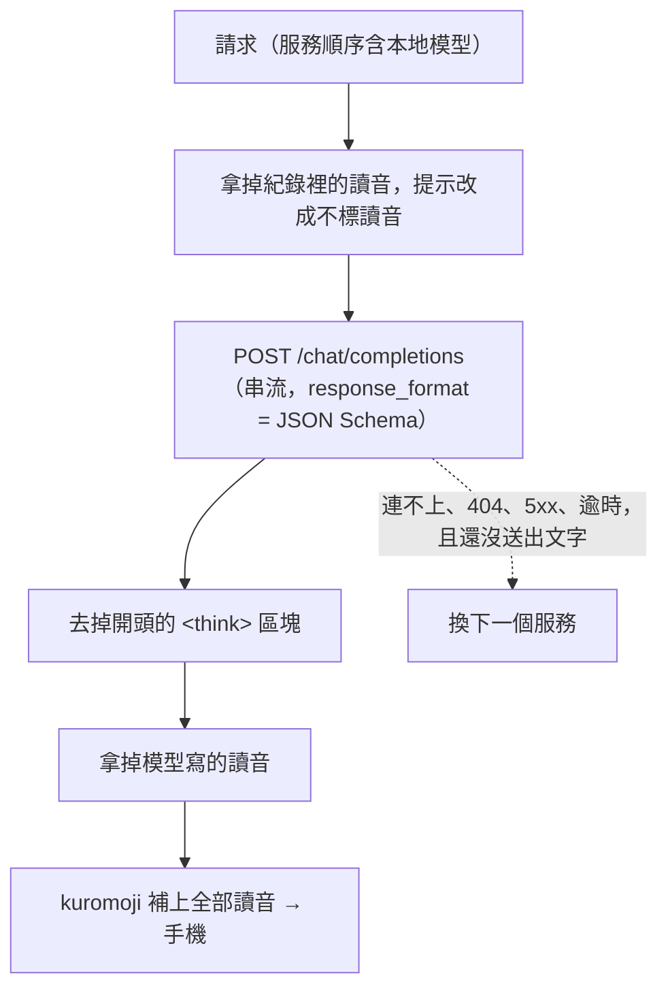

# 0010 本地模型：OpenAI 相容 API，讀音交給程式

- 狀態：已採用

## 背景
有人想不花 API 費用、或不想讓對話離開自己的電腦，改用電腦上的開源小模型。小模型的問題很明確：漢字讀音常標錯、比較會漏格式、第一次載入很慢。0009 的服務清單與轉接器已經有了，問題是要接哪一種本地伺服器，以及怎麼補小模型的弱點。

## 考慮過的選項
**A. 只接 Ollama 自己的 API**
- 優點：可以直接設定 `num_ctx`、關掉思考。
- 缺點：只能用 Ollama；LM Studio、llama.cpp 都要另外寫。

**B. OpenAI 相容的 Chat Completions（採用）**
- 優點：Ollama、LM Studio、llama.cpp 的 `llama-server`、vLLM 都有；JSON Schema 用 `response_format` 送，伺服器會限制輸出格式。
- 缺點：長度上限、思考開關要在伺服器那邊設定，這裡管不到。

**C. 把 Anthropic SDK 指到本地伺服器（ANTHROPIC_BASE_URL）**
- 優點：幾乎不用寫程式。
- 缺點：本地伺服器多半不認得 Structured Outputs、測試功能和快取點；花費會被當成 Claude 計入每日上限。

## 決定
新增第三個服務「本地模型」（`local`），走 OpenAI 相容的 Chat Completions。網址預設是 Ollama 的 `http://127.0.0.1:11434/v1`，模型沒指定就用伺服器清單裡第一個不是 embedding 的模型。網址與模型名稱可以在電腦上的設定填（寫進 `.env.local`），手機只看狀態。

讀音全部交給程式：本地模型的提示不要求讀音、送去的對話紀錄拿掉讀音、模型自己寫的讀音也先拿掉，最後由 kuromoji 全部補上。

## 做法

- 不計入每日預算，不佔預留額度；聊天的速率限制照常。
- 串流上限 180 秒（第一次載入模型可能很久）；單次請求至少 30 秒。
- 狀態 `GET /api/local/status` 每次都重新問伺服器；手機在開設定、回到畫面時會重問。

## 取捨
- 長度上限：系統提示加對話紀錄最多約 8K token，Ollama 的長度上限要自己調高，這裡無法替使用者設定。
- 思考模型：思考內容若放在獨立欄位就不讀；若混在文字裡，只去掉開頭的 `<think>…</think>`。開關思考要在伺服器那邊設定。
- 讀音改由 kuromoji 全包：多數情況比小模型準，但同形異讀（例如「今日」）可能選錯讀法。
- 糾錯與解說的品質取決於模型，小模型會比 Claude 弱；這部分程式補不了。
- 網址只能在電腦上改，避免從手機把對話導到別的機器；網址不能帶帳號密碼、查詢字串或片段。

## 何時重新評估
- 本地伺服器普遍支援 Responses API 或 Anthropic Messages 格式 → 看能不能和 ChatGPT 的轉接器合併。
- 小模型的讀音準確度明顯提升 → 考慮讓模型自己標讀音，程式只補漏。
