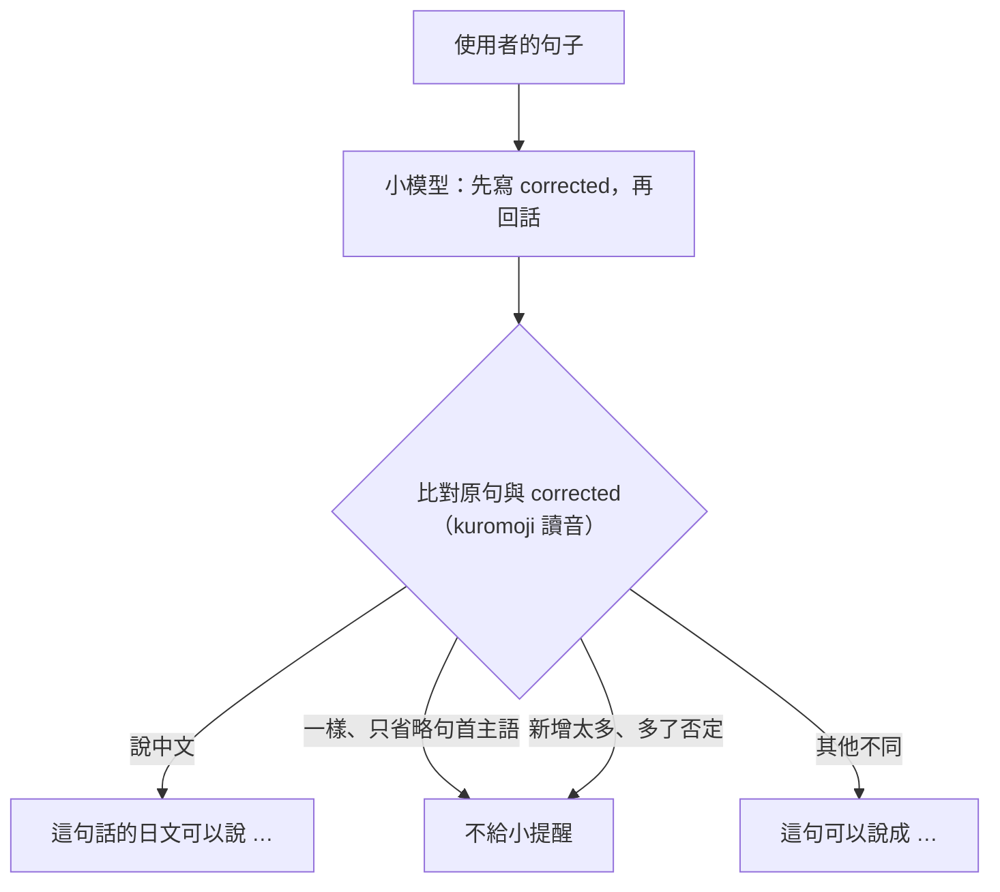

# 0011 小模型抓錯：讓模型改寫句子，由程式比對

- 狀態：已採用

## 背景
0010 加了本地模型之後實測：Qwen3 4B 和 8B 幾乎從不寫小提醒，8 個常見錯誤一個都沒教；8B 偶爾寫了，解釋也約一半是錯的（例如把「会うました」解釋成要把「に」改成「と」）。小提醒是這個 App 的核心，本地模型要能用，抓錯必須改善。

## 考慮過的選項
**A. 在提示裡更嚴格要求寫小提醒**
- 優點：不用改程式。
- 缺點：實測後小提醒還是常空白，有寫的解釋也常錯。

**B. 另外送一次請求，只做檢查**
- 優點：一次只做一件事，小模型比較做得到。
- 缺點：每句多一次請求；在沒有顯示卡的電腦上，每句要多等十幾秒。

**C. 回覆裡先寫一欄「改寫」，小提醒由程式比對產生（採用）**
- 優點：把使用者的句子改寫正確，比邊聊天邊挑錯容易；不用多送請求。程式比對原句和改寫，就知道有沒有錯。
- 缺點：小提醒只有正確說法，沒有「為什麼」。

## 決定
本地模型的回覆格式改成三欄：`corrected`（使用者那句話的正確日文；說中文就翻成日文，沒錯就照抄）、`segments`、`tone`。模型不寫小提醒，由伺服器依 `corrected` 產生：
- 說中文 →「這句話的日文可以說 …」。
- 說日文，改寫和原句不同 →「這句可以說成 …」。
- 其他情況不給小提醒。

模型自己的解釋不顯示（使用者選擇「只顯示正確句子」：不會教錯，比解釋原因重要）。Claude 與 ChatGPT 不受影響。

## 做法

- 比對用讀音（kuromoji），漢字寫成假名不算不同；標點、空白不算。
- 不當作修正的情況，都來自實測看到的誤判：
  - 改寫新增的內容超過原句的 0.4：模型在 corrected 裡寫了自己的話。真正的修正最多新增 0.29，這類改寫新增 0.44、0.50。
  - 改寫比原句多了否定（ない、ません）：8B 兩次把「先週東京へ行きます」改成「行きませんでした」。
  - 只省略句首的「私は／僕は」等主語：日文本來就常省略，不是錯。
- `corrected` 不會顯示，也不會存進對話紀錄。

## 實測（12 句：8 句常見錯誤、2 句正確、2 句中文；4 核心 CPU，llama-cpp-python）
| | 抓到錯誤 | 正確句子沒誤報 | 中文教日文 | 每句時間 |
| --- | --- | --- | --- | --- |
| Qwen3 8B，改之前 | 0/8 | 2/2（從不寫小提醒） | 0/2 | 約 10–20 秒 |
| Qwen3 8B，改之後 | 7/8 | 2/2 | 2/2 | 約 20 秒 |
| Qwen3 4B，改之前 | 0/8 | 2/2（從不寫小提醒） | 0/2 | 約 10–15 秒 |
| Qwen3 4B，改之後 | 5/8 | 1/2 | 2/2 | 約 12 秒 |

- 8B 沒抓到的一句是「先週東京へ行きます」：它改成否定句，被程式擋下，所以不給小提醒，而不是給錯的。
- 4B 的「改之後」是用上一版提示的改寫，以最後的比對規則重算的。
- 每種情況各跑一次，題數少，數字只能看大概。

## 取捨
- 小提醒只有正確說法，沒有解釋原因。
- 同形異讀（例如「家」讀いえ或うち）：使用者用假名寫了另一種讀法時，可能被當成不同，給出一句其實不必要的小提醒。
- 門檻（新增 0.4）和例外（否定、主語）只用少數實測句子定出來，換模型可能需要再調。
- 模型改寫錯了，而且沒被規則擋下時，小提醒就會教錯（4B 把「映画を見に行きました」改成「映画館に行きました」）。

## 何時重新評估
- 小模型寫的解釋變得可靠 → 考慮讓模型自己寫小提醒，或在正確句子後面附上解釋。
- 換推薦的模型 → 用同一組句子重測門檻與例外。
